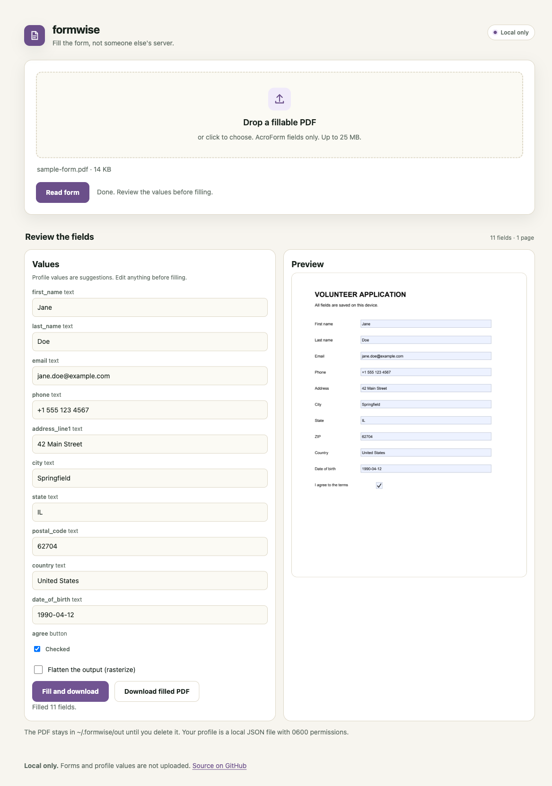

# formwise

[](https://github.com/iambiniyam/formwise/actions/workflows/ci.yml)
[](LICENSE)

Fill PDF forms locally from a private profile.

Drop in a fillable PDF. formwise reads the fields, matches them to your profile, lets you review every value, and fills the form on your machine.



Status: v0.1.7.

## Why

See [how this compares](docs/comparison.md) with the closest tools.

Immigration, tax, school, medical, and rental forms ask for the same details again and again. Most online PDF fillers upload the form and the answers to a server.

formwise keeps both local. It matches common field names, shows its work, and only fills after you review.

## What it does

- Reads AcroForm text fields, checkboxes, radio groups, and choice lists.
- Matches field names such as `fname`, `surname`, `zip`, and `date_of_birth`.
- Suggests values from a local profile with `0600` permissions.
- Encrypts the profile with a passphrase when you pass `--encrypt`.
- Lets you override every value before filling.
- Optionally flattens the result by rasterizing the pages.
- Runs as a CLI and a local web UI.
- Fills a whole folder from the CLI and writes an audit log with field counts and no values.
- Flags scanned PDFs with no AcroForm fields.
- Lets you place text values directly on the page preview of a scanned PDF, with page navigation.

## Quickstart

```bash
git clone https://github.com/iambiniyam/formwise.git
cd formwise
uv venv && source .venv/bin/activate
uv pip install -e ".[dev]"
formwise profile --encrypt --out profile.json
formwise fields examples/sample-form.pdf
formwise fill examples/sample-form.pdf --profile profile.json -o filled.pdf
formwise serve
```

`formwise profile` writes a sample profile with mode 0600. Edit it with your own values and keep it private.

## CLI

```bash
# create a profile
formwise profile --encrypt --out profile.json

# inspect fields
formwise fields form.pdf

# fill from the profile
formwise fill form.pdf --profile profile.json -o filled.pdf

# override one field
formwise fill form.pdf --profile profile.json --set first_name=Jane -o filled.pdf

# rasterize the result
formwise fill form.pdf --profile profile.json --flatten -o filled.pdf
```

## Web UI

`formwise serve` opens a local page with:

- PDF upload
- field-by-field review with profile suggestions
- editable values for every field
- a PDF preview
- optional flattening
- a filled PDF download
- loading, empty, and error states
- automatic dark mode and mobile layouts
- keyboard access and visible focus

The page has no external fonts, scripts, or CDNs.

## How matching works

Each field name is normalized and compared with a small alias table:

| Profile key | Matches |
|---|---|
| `first_name` | first name, firstname, given name, fname |
| `last_name` | last name, surname, family name, lname |
| `email` | email, e-mail, email address |
| `phone` | phone, mobile, telephone, tel, cell |
| `address_line1` | address, street, address line 1 |
| `city`, `state`, `postal_code` | city, province, state, zip, postal code |
| `date_of_birth` | date of birth, dob, birthdate |

Unmatched fields stay blank. The UI shows every field so you can fix it.

## Privacy

- No network calls at runtime.
- The profile is local and has `0600` permissions.
- With `--encrypt`, the profile is encrypted at rest with a passphrase. You will be prompted when filling.
- Uploaded PDFs and filled outputs stay in `~/.formwise/out` until you delete them.
- The web UI binds to 127.0.0.1.
- No telemetry and no accounts.
- Batch audit logs record field counts and blank field names, never values.

## Limits

- Digital and scanned forms are not supported yet. Only PDFs with AcroForm fields.
- A wrong match is possible. Review every field.
- Scanned-form placement is manual. Preview generation covers up to 10 pages.
- Flattening rasterizes the PDF, so text is no longer selectable.
- Without `--encrypt`, the profile is plain JSON on disk. Encrypt it or keep it on an encrypted disk.
- The current UI handles one PDF at a time.

## Tests

```bash
pytest -q
```

The suite covers profile matching, field inspection, text and checkbox filling, encryption, batch filling, audit safety, preview, and flattening. It has 8 tests.

## Packaging

formwise is a Python package. It is not an npm package because the PDF runtime is Python.

- PyPI: `pip install formwise`
- Release wheel: `pip install https://github.com/iambiniyam/formwise/releases/download/v0.1.7/formwise-0.1.7-py3-none-any.whl`
- The release workflow uses PyPI Trusted Publishing. A maintainer configures the PyPI project and the `pypi` environment once, then sets the repository variable `PUBLISH_PYPI=true`. No API token is stored in the repository. Until that setup exists, install the wheel attached to the GitHub release.

## Roadmap

- scanned PDF field detection with OCR
- multi-page form layouts
- signature fields with a clear review step
- XFA form support
- an audit log of what was filled

## Related tools

- [alttext](https://github.com/iambiniyam/alttext): local alt text and accessibility audit.
- [walkthrough](https://github.com/iambiniyam/walkthrough): screenshots to step-by-step guides.
- [redact](https://github.com/iambiniyam/redact): offline PII redaction.
- [snap2sheet](https://github.com/iambiniyam/snap2sheet): receipts to spreadsheets.

## License

MIT. See [THIRD_PARTY.md](THIRD_PARTY.md).
